# FRC device icons

SVG drawings of common FRC robot devices, made by FRC Team 2102 Paradox for our wiring diagrams.
Use them in your own diagrams, docs and posters.

- One SVG unit is one millimetre, so all the icons have the same scale.
- Each icon shows the face that you wire. The shapes come from each vendor's published drawings and photos.
- Each wire end is an invisible `<circle class="anchor" id="anchor-<port>">` where a diagram can attach a
  wire. Its `data-kind` is `power`, `can`, `ethernet`, `usb`, `signal` or `air`.
- The folders are `<type>/<vendor>/<device>.svg`. [`index.json`](index.json) lists every icon with its size
  and wire ends, for scripts.
- To get one icon, open it here and use **Download raw file**, or get it from
  `https://docs.team2102.org/icons/<type>/<vendor>/<file>`.
- To get them all, download [frc-device-icons.zip](frc-device-icons.zip) (every icon, with this README,
  the license and `index.json`).

**License:** public domain, [CC0 1.0](LICENSE.md). Use them for anything, no credit needed.
We ask one thing (a request, not a condition): please do not present the icons as your own work.
The product names belong to their makers.

The wiring tools write this folder (`export_prettydocs.py`): do not edit these files by hand.

- [Robot controllers](#robot-controllers) (2)
- [Power](#power) (11)
- [Motor controllers](#motor-controllers) (10)
- [Motors](#motors) (14)
- [Radio and CAN](#radio-and-can) (8)
- [Lights](#lights) (3)
- [Sensors and encoders](#sensors-and-encoders) (17)
- [Vision and coprocessors](#vision-and-coprocessors) (12)
- [Pneumatics](#pneumatics) (6)
- [Driver station](#driver-station) (1)

## Robot controllers

| Icon | File | Device | Vendor | Status |
|---|---|---|---|---|
| 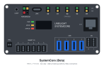 | [systemcore.svg](controllers/limelight/systemcore.svg) | Limelight Systemcore (Beta hardware) | Limelight Vision | current |
| 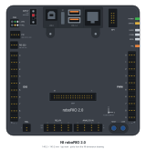 | [roborio-2.svg](controllers/ni/roborio-2.svg) | roboRIO 2.0 Embedded Controller for FRC | NI | legacy (not sold) |

## Power

| Icon | File | Device | Vendor | Status |
|---|---|---|---|---|
| 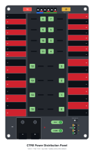 | [ctre-pdp.svg](power/ctre/ctre-pdp.svg) | Power Distribution Panel (PDP) | CTR Electronics | legacy (not sold) |
| 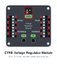 | [ctre-vrm.svg](power/ctre/ctre-vrm.svg) | Voltage Regulator Module (VRM) | CTR Electronics | legacy (not sold) |
| 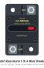 | [main-breaker-120a.svg](power/eaton/main-breaker-120a.svg) | 120 A main circuit breaker (Eaton Bussmann Series 185 surface mount, CB185-120 / 185120F) | Eaton Bussmann | current |
| 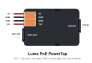 | [poe-powertap.svg](power/luma/poe-powertap.svg) | Luma PoE PowerTap | Luma Vision | current |
| 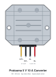 | [protooma-5v-10a.svg](power/protooma/protooma-5v-10a.svg) | DC-DC step-down converter, 12/24 V to 5 V 10 A 50 W ("LED brick") | Protooma | current |
| 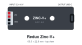 | [redux-zinc-v.svg](power/redux/redux-zinc-v.svg) | Zinc-V (current production: Zinc-V+ / "ZINC-V Plus") inline buck converter | Redux Robotics | current |
| 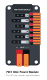 | [rev-mpm.svg](power/rev/rev-mpm.svg) | Mini Power Module (MPM) | REV Robotics | current |
| 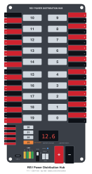 | [rev-pdh.svg](power/rev/rev-pdh.svg) | Power Distribution Hub (PDH) | REV Robotics | current |
| 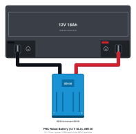 | [frc-battery-sb120.svg](power/generic/frc-battery-sb120.svg) | FRC robot battery: 12 V 18 Ah sealed lead-acid with the FRC lead set (6 AWG leads, blue Anderson SB120) | Several makers | current |
| 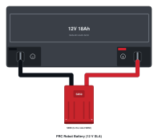 | [frc-battery.svg](power/generic/frc-battery.svg) | FRC robot battery: 12 V 18 Ah sealed lead-acid with the FRC lead set (6 AWG leads, red Anderson SB50) | Several makers | current |
| 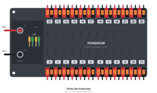 | [thrifty-powerhub.svg](power/thrifty-bot/thrifty-powerhub.svg) | PowerHub | The Thrifty Bot | current |

## Motor controllers

| Icon | File | Device | Vendor | Status |
|---|---|---|---|---|
| 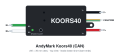 | [koors40-can.svg](motor-controllers/andymark/koors40-can.svg) | AndyMark Koors40 Brushed DC Motor Controller (CAN + PWM) | AndyMark | current |
| 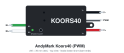 | [koors40-pwm.svg](motor-controllers/andymark/koors40-pwm.svg) | AndyMark Koors40 Brushed DC Motor Controller (PWM only) | AndyMark | current |
| 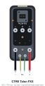 | [talon-fxs.svg](motor-controllers/ctre/talon-fxs.svg) | Talon FXS | CTR Electronics | current |
| 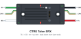 | [talon-srx.svg](motor-controllers/ctre/talon-srx.svg) | Talon SRX | CTR Electronics | legacy (not sold) |
| 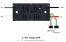 | [victor-spx.svg](motor-controllers/ctre/victor-spx.svg) | Victor SPX | CTR Electronics | legacy (not sold) |
| 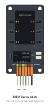 | [servo-hub.svg](motor-controllers/rev/servo-hub.svg) | Servo Hub | REV Robotics | current |
| 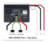 | [spark-flex-dock.svg](motor-controllers/rev/spark-flex-dock.svg) | SPARK Flex + Flex Dock | REV Robotics | current |
| 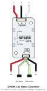 | [spark-lite.svg](motor-controllers/rev/spark-lite.svg) | SPARK Lite Motor Controller | REV Robotics | current |
| 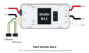 | [spark-max.svg](motor-controllers/rev/spark-max.svg) | SPARK MAX Motor Controller | REV Robotics | current |
| 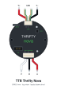 | [thrifty-nova.svg](motor-controllers/thrifty-bot/thrifty-nova.svg) | Thrifty Nova | The Thrifty Bot | current |

## Motors

| Icon | File | Device | Vendor | Status |
|---|---|---|---|---|
| 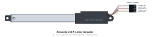 | [actuonix-l16-p.svg](motors/actuonix/actuonix-l16-p.svg) | Actuonix L16-P Micro Linear Actuator (potentiometer feedback) | Actuonix Motion Devices | current |
| 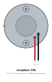 | [cim.svg](motors/andymark/cim.svg) | CIM Motor 2.5 in. | AndyMark | current |
| 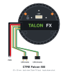 | [falcon-500.svg](motors/ctre/falcon-500.svg) | Falcon 500 Powered by Talon FX | CTR Electronics | legacy (not sold) |
| 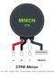 | [minion.svg](motors/ctre/minion.svg) | Minion Brushless Motor | CTR Electronics | current |
| 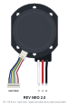 | [neo-2.svg](motors/rev/neo-2.svg) | NEO 2.0 Brushless Motor | REV Robotics | current |
| 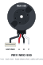 | [neo-550.svg](motors/rev/neo-550.svg) | NEO 550 Brushless Motor | REV Robotics | current |
| 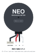 | [neo.svg](motors/rev/neo.svg) | NEO Brushless Motor V1.1 | REV Robotics | legacy (not sold) |
| 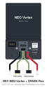 | [neo-vortex-spark-flex.svg](motors/rev/neo-vortex-spark-flex.svg) | NEO Vortex + SPARK Flex | REV Robotics | current |
| 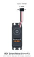 | [smart-robot-servo.svg](motors/rev/smart-robot-servo.svg) | Smart Robot Servo V2 (Balanced REV-41-3334, UltraSpeed REV-41-3336) | REV Robotics | current |
| 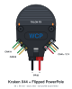 | [kraken-x44-powerpole-flipped.svg](motors/wcp/kraken-x44-powerpole-flipped.svg) | Kraken X44 + Flipped PowerPole Adapter Board (low profile) | WestCoast Products | current |
| 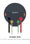 | [kraken-x44.svg](motors/wcp/kraken-x44.svg) | Kraken X44 Powered by Talon FX | WestCoast Products | current |
| 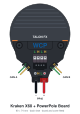 | [kraken-x60-powerpole.svg](motors/wcp/kraken-x60-powerpole.svg) | Kraken X60 + PowerPole Adapter Board | WestCoast Products | current |
| 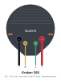 | [kraken-x60.svg](motors/wcp/kraken-x60.svg) | Kraken X60 Powered by Talon FX | WestCoast Products | current |
| 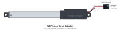 | [wcp-linear-servo-actuator.svg](motors/wcp/wcp-linear-servo-actuator.svg) | WCP Miniature Linear Servo Actuator (L16-R) | WestCoast Products | current |

## Radio and CAN

| Icon | File | Device | Vendor | Status |
|---|---|---|---|---|
| 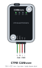 | [canivore.svg](communication/ctre/canivore.svg) | CANivore (USB to CAN FD) | CTR Electronics | current |
| 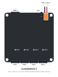 | [lumaswitch-2.svg](communication/luma/lumaswitch-2.svg) | LumaSwitch 2 | Luma Vision | current |
| 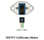 | [swyft-canender-molex.svg](communication/swyft/swyft-canender-molex.svg) | SWYFT CANender (Molex SL) | SWYFT Robotics | current |
| 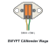 | [swyft-canender-wago.svg](communication/swyft/swyft-canender-wago.svg) | SWYFT CANender (Wago) | SWYFT Robotics | current |
| 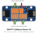 | [swyft-direct-v2.svg](communication/swyft/swyft-direct-v2.svg) | SWYFT CANnect Direct V2 | SWYFT Robotics | current |
| 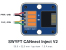 | [swyft-inject-v2.svg](communication/swyft/swyft-inject-v2.svg) | SWYFT CANnect Inject V2 | SWYFT Robotics | current |
| 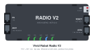 | [robot-radio-v2.svg](communication/vivid-hosting/robot-radio-v2.svg) | Vivid-Hosting Robot Radio V2 (FRC Radio V2) | Vivid-Hosting | current |
| 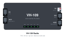 | [vh-109.svg](communication/vivid-hosting/vh-109.svg) | Vivid-Hosting VH-109 FRC Robot Radio | Vivid-Hosting | current |

## Lights

| Icon | File | Device | Vendor | Status |
|---|---|---|---|---|
| 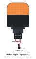 | [rsl.svg](lights/allen-bradley/rsl.svg) | Robot Signal Light (Allen-Bradley 855PB panel-mount LED beacon, 45 mm, amber, 12 V) | Allen-Bradley (Rockwell Automation) | current |
| 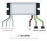 | [candle.svg](lights/ctre/candle.svg) | CANdle (CAN LED controller and 5 V regulator) | CTR Electronics | current |
| 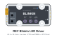 | [blinkin.svg](lights/rev/blinkin.svg) | Blinkin LED Driver | REV Robotics | current |

## Sensors and encoders

| Icon | File | Device | Vendor | Status |
|---|---|---|---|---|
| 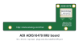 | [adis16470.svg](sensors/analog-devices/adis16470.svg) | ADIS16470 IMU Board for FIRST Robotics | Analog Devices | legacy (not sold) |
| 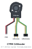 | [cancoder.svg](sensors/ctre/cancoder.svg) | CANcoder (magnetic absolute rotary encoder) | CTR Electronics | current |
|  | [candi.svg](sensors/ctre/candi.svg) | CANdi (CAN digital input) | CTR Electronics | current |
|  | [canrange.svg](sensors/ctre/canrange.svg) | CANrange (CAN time-of-flight distance sensor) | CTR Electronics | current |
|  | [pigeon2.svg](sensors/ctre/pigeon2.svg) | Pigeon 2.0 IMU | CTR Electronics | current |
|  | [canandgyro.svg](sensors/redux/canandgyro.svg) | Boron Canandgyro (6-axis IMU) | Redux Robotics | current |
|  | [canandmag.svg](sensors/redux/canandmag.svg) | Helium Canandmag (magnetic absolute encoder) | Redux Robotics | current |
|  | [canandcolor.svg](sensors/redux/canandcolor.svg) | Phosphorus Canandcolor (color and proximity sensor) | Redux Robotics | current |
|  | [distance-sensor-2m.svg](sensors/rev/distance-sensor-2m.svg) | 2m Distance Sensor | REV Robotics | current |
|  | [color-sensor-v3.svg](sensors/rev/color-sensor-v3.svg) | Color Sensor V3 | REV Robotics | current |
|  | [magnetic-limit-switch.svg](sensors/rev/magnetic-limit-switch.svg) | Magnetic Limit Switch | REV Robotics | current |
|  | [rev-through-bore.svg](sensors/rev/rev-through-bore.svg) | Through Bore Encoder (V1) | REV Robotics | legacy (not sold) |
|  | [rev-through-bore-v2.svg](sensors/rev/rev-through-bore-v2.svg) | Through Bore Encoder V2 | REV Robotics | current |
|  | [navx2-mxp.svg](sensors/studica/navx2-mxp.svg) | navX2-MXP Robotics Navigation Sensor | Studica | current |
|  | [swyft-sense-limit-switch.svg](sensors/swyft/swyft-sense-limit-switch.svg) | SWYFT Sense Magnetic Limit Switch (V1.1) | SWYFT Robotics | current |
|  | [thrifty-encoder.svg](sensors/thrifty-bot/thrifty-encoder.svg) | Thrifty Absolute Magnetic Encoder | The Thrifty Bot | current |
|  | [wcp-throughbore.svg](sensors/wcp/wcp-throughbore.svg) | WCP ThroughBore Powered by CANcoder (1/2" Hex) | WestCoast Products | current |

## Vision and coprocessors

| Icon | File | Device | Vendor | Status |
|---|---|---|---|---|
|  | [arducam-ov9281-usb.svg](vision/arducam/arducam-ov9281-usb.svg) | Arducam 1MP OV9281 Global Shutter USB Camera Board (low-distortion M12 lens, no microphone) | Arducam | current |
|  | [arducam-ov9782-usb.svg](vision/arducam/arducam-ov9782-usb.svg) | Arducam 1MP OV9782 Global Shutter Color USB Camera | Arducam | current |
|  | [arducam-ov2311-usb.svg](vision/arducam/arducam-ov2311-usb.svg) | Arducam 2MP OV2311 Global Shutter Monochrome USB Camera | Arducam | current |
|  | [innomaker-ov9281-usb.svg](vision/innomaker/innomaker-ov9281-usb.svg) | innomaker U20CAM-9281M OV9281 Global Shutter USB 2.0 UVC Camera | innomaker | current |
|  | [limelight-3g.svg](vision/limelight/limelight-3g.svg) | Limelight 3G | Limelight Vision | legacy (not sold) |
|  | [limelight-4.svg](vision/limelight/limelight-4.svg) | Limelight 4 | Limelight Vision | current |
|  | [luma-p1.svg](vision/luma/luma-p1.svg) | Luma P1 | Luma Vision | legacy (not sold) |
|  | [luma-p2.svg](vision/luma/luma-p2.svg) | Luma P2 | Luma Vision | current |
|  | [orangepi-5.svg](vision/orange-pi/orangepi-5.svg) | Orange Pi 5 | Orange Pi | current |
|  | [orangepi-5-pro.svg](vision/orange-pi/orangepi-5-pro.svg) | Orange Pi 5 Pro | Orange Pi | current |
|  | [raspberry-pi-5.svg](vision/raspberry-pi/raspberry-pi-5.svg) | Raspberry Pi 5 | Raspberry Pi | current |
|  | [swyft-usb-camera.svg](vision/swyft/swyft-usb-camera.svg) | SWYFT USB Camera (OV9281-class, locking USB-C) | SWYFT Robotics | current |

## Pneumatics

| Icon | File | Device | Vendor | Status |
|---|---|---|---|---|
|  | [ckd-double-solenoid.svg](pneumatics/ckd/ckd-double-solenoid.svg) | CKD 4GA1 double solenoid valve, M5, 12 VDC (4GA120-M5-4) | CKD | current |
|  | [ckd-single-solenoid.svg](pneumatics/ckd/ckd-single-solenoid.svg) | CKD 4GA1 single solenoid valve, M5, 12 VDC (4GA110-M5-4) | CKD | current |
|  | [ctre-pcm.svg](pneumatics/ctre/ctre-pcm.svg) | Pneumatics Control Module (PCM) | CTR Electronics | legacy (not sold) |
|  | [rev-pressure-sensor.svg](pneumatics/rev/rev-pressure-sensor.svg) | Analog Pressure Sensor | REV Robotics | current |
|  | [rev-ph.svg](pneumatics/rev/rev-ph.svg) | Pneumatic Hub (PH) | REV Robotics | current |
|  | [viair-90c.svg](pneumatics/viair/viair-90c.svg) | 90C Compressor | VIAIR | current |

## Driver station

| Icon | File | Device | Vendor | Status |
|---|---|---|---|---|
|  | [dell-latitude.svg](driver-station/dell/dell-latitude.svg) | Dell Latitude 5450 (14 inch business laptop, driver station) | Dell | current |
