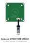
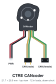
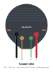
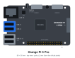
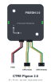
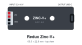
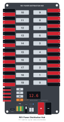
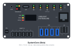
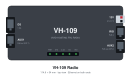
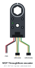

# Device icons

Drawings of the devices on Team 2102's robots, made for our wiring diagrams. You can use them in your own diagrams.

- One SVG unit is one millimetre, so all the icons have the same scale.
- Each wire end is an invisible `<circle class="anchor" id="anchor-<port>">`, where a diagram can attach a wire.
- The shapes come from each vendor's published drawings.
- To get one icon, open it here and use **Download raw file**, or get it from
  `https://docs.team2102.org/icons/<file>`.

The wiring tools write this folder (`export_prettydocs.py`): do not edit these files by hand.

| Icon | File | Device | Vendor |
|---|---|---|---|
|  | [arducam-ov9281-usb.svg](arducam-ov9281-usb.svg) | Arducam 1MP OV9281 Global Shutter USB Camera Board (low-distortion M12 lens, no microphone) | Arducam (Arducam Technology / UCTRONICS) |
|  | [cancoder.svg](cancoder.svg) | CANcoder (magnetic absolute rotary encoder) | CTR Electronics (Cross The Road Electronics) |
|  | [kraken-x44.svg](kraken-x44.svg) | Kraken X44 Powered by Talon FX | WestCoast Products (WCP); integrated controller and assembly by CTR Electronics |
|  | [kraken-x60.svg](kraken-x60.svg) | Kraken X60 Powered by Talon FX | WestCoast Products (WCP); integrated controller and assembly by CTR Electronics |
|  | [orangepi-5-pro.svg](orangepi-5-pro.svg) | Orange Pi 5 Pro | Shenzhen Xunlong Software Co., Ltd. (Orange Pi) |
|  | [pigeon2.svg](pigeon2.svg) | Pigeon 2.0 IMU | CTR Electronics (CTRE) |
|  | [redux-zinc-v.svg](redux-zinc-v.svg) | Zinc-V (current production: Zinc-V+ / "ZINC-V Plus") inline buck converter | Redux Robotics |
|  | [rev-pdh.svg](rev-pdh.svg) | Power Distribution Hub (PDH) | REV Robotics |
|  | [systemcore.svg](systemcore.svg) | Limelight Systemcore (Beta hardware) | Limelight Vision (for FIRST / WPILib) |
|  | [vh-109.svg](vh-109.svg) | Vivid-Hosting VH-109 FRC Robot Radio | Vivid-Hosting, LLC (sold/supported in the US by WestCoast Products) |
|  | [wcp-throughbore.svg](wcp-throughbore.svg) | WCP ThroughBore Powered by CANcoder (1/2" Hex) | WestCoast Products (WCP), co-developed with and also sold by CTR Electronics |
